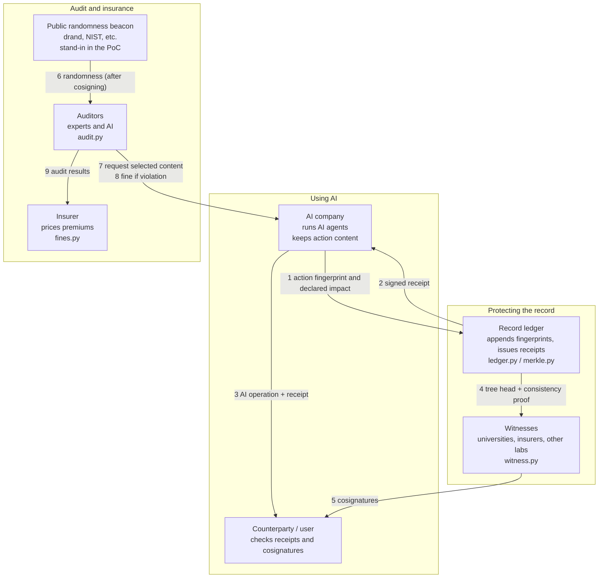
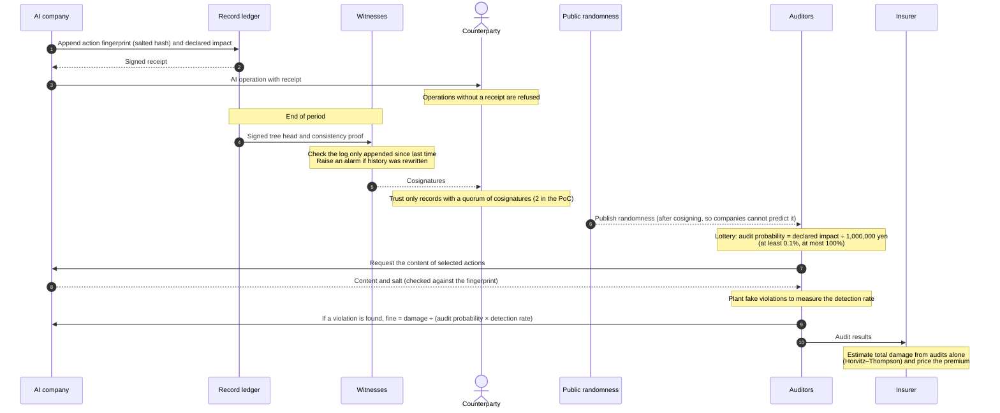
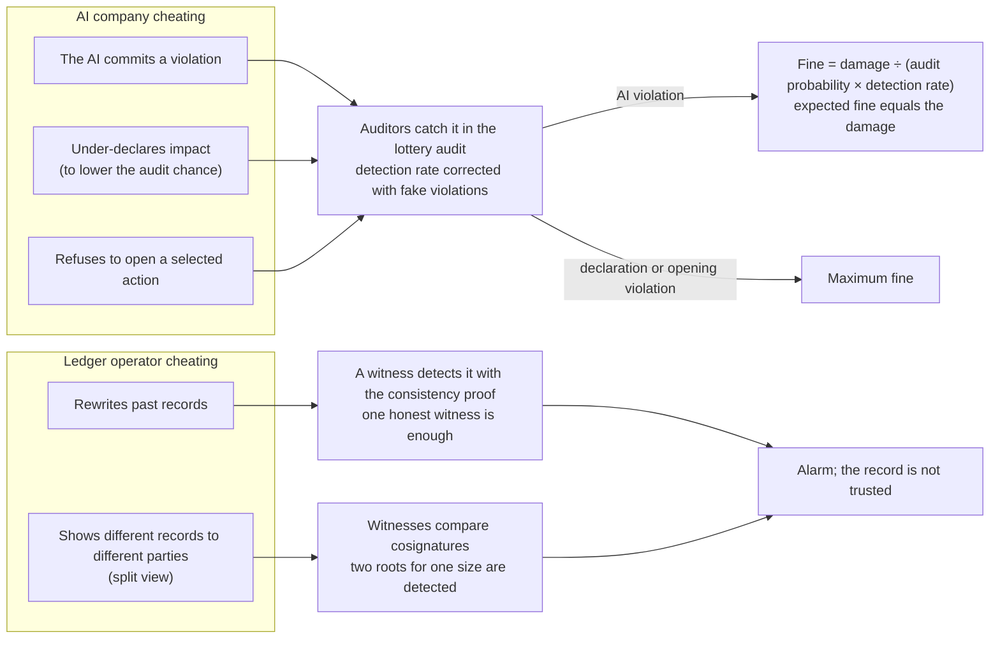
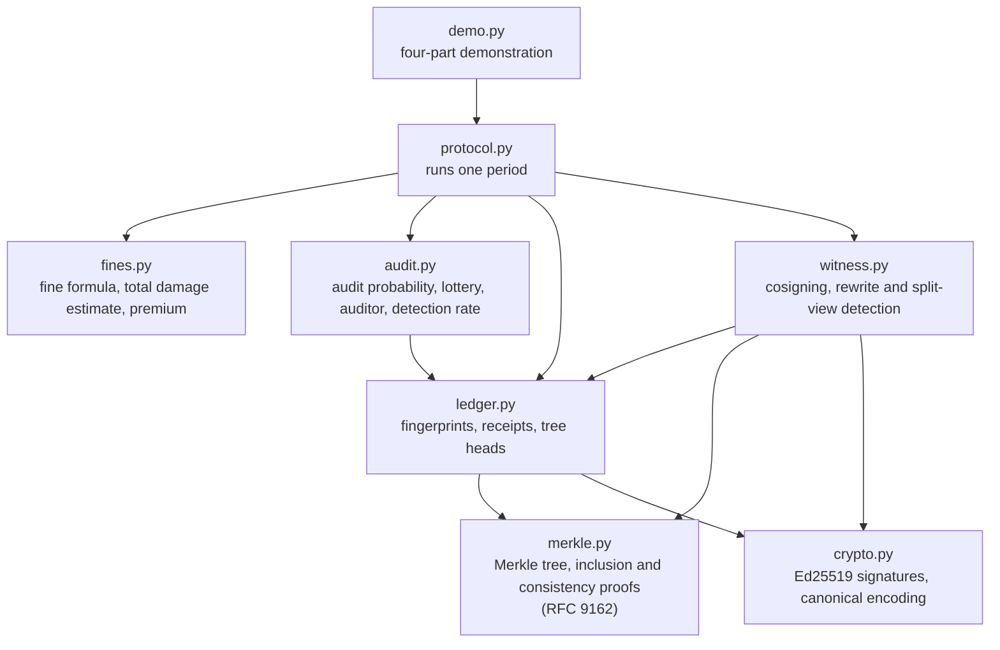

# Architecture: who is involved and how it fits together

[日本語](ARCHITECTURE_ja.md)

This page shows the parties in the proof of concept, the flow of one audit period, how cheating is caught, and how the code is organised.

## 1. Parties and connections

An AI company records each action's fingerprint in the record ledger and keeps the content itself. Witnesses watch the ledger, and auditors examine only the actions the lottery selects. Audit results feed both fines and insurance pricing.

## 2. One audit period

`Protocol.submit` and `Protocol.close_period` in `protocol.py` run this flow for one period.

## 3. Who cheats, and who catches it

Both AI companies and the ledger operator could cheat. Each kind of cheating has a mechanism that catches it and a fixed consequence.

## 4. Code structure

Arrows mean "uses". The only cryptography is SHA-256 and Ed25519; there is no blockchain and no token.

## PoC versus a real deployment

| Part | This PoC | Needed in a real deployment |
| --- | --- | --- |
| Record ledger | In memory, one process | A networked service with persistent storage |
| Witnesses | Three parties in the same process | A network of witnesses run by independent organisations |
| Public randomness | A stand-in derived from a fixed string | drand or the NIST Randomness Beacon |
| Auditors | Modelled as a detection probability | Real experts and AI, with measured detection rates |
| Counterparties and insurers | Verification and estimation functions | Integration into each organisation's systems |
