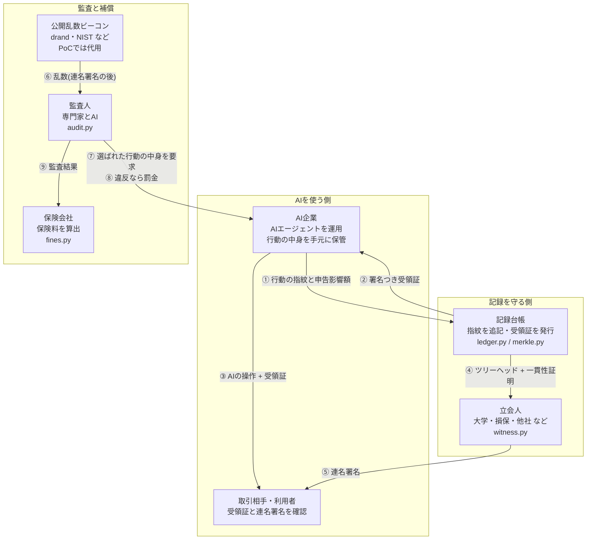
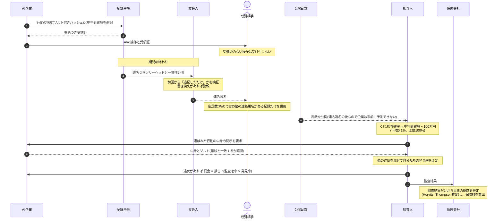
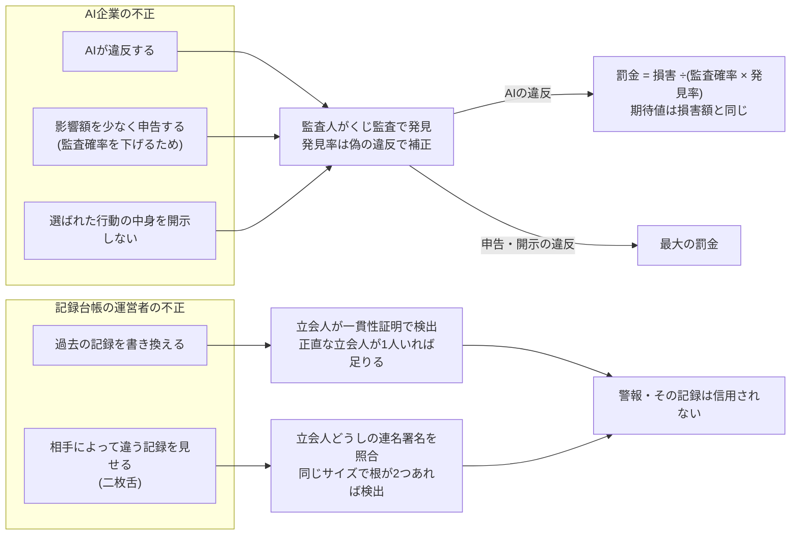
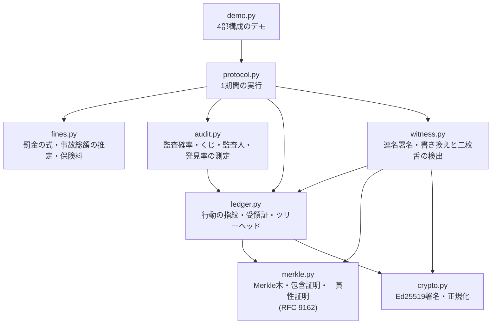

# アーキテクチャ:関係者・流れ・つながり

[English](ARCHITECTURE.md)

このPoCに登場する関係者と、1回の監査期間の流れ、不正の見抜き方、コードとの対応を図で示す。

## 1. 関係者とつながり

AI企業は行動の指紋を記録台帳に残し、中身は手元に保管する。立会人が台帳を見張り、くじで選ばれた行動だけを監査人が調べる。監査結果は罰金と保険料の両方に使われる。

## 2. 1回の監査期間の流れ

`protocol.py` の `Protocol.submit` と `Protocol.close_period` が、この流れを1期間分実行する。

## 3. 誰の不正を、誰が見抜くか

不正をする可能性があるのは、AI企業と記録台帳の運営者の両方。どちらの不正にも、見抜く仕組みと結果が決まっている。

## 4. コードの構成

矢印は「使う」関係。暗号には SHA-256 と Ed25519 だけを使い、ブロックチェーンや独自通貨は使わない。

## PoCと実運用の違い

| 部分 | このPoC | 実運用で必要なもの |
| --- | --- | --- |
| 記録台帳 | 1プロセスのメモリ上 | ネットワーク上のサービスと永続的な保存 |
| 立会人 | 同じプロセス内の3者 | 独立した組織が運営する立会人のネットワーク |
| 公開乱数 | 固定の文字列から作る代用品 | drand や NIST の乱数ビーコン |
| 監査人 | 発見率という確率でモデル化 | 実際の専門家とAI。発見率は実測が必要 |
| 取引相手・保険会社 | 検証関数と推定関数として実装 | 各社のシステムへの組み込み |
